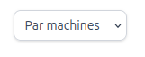
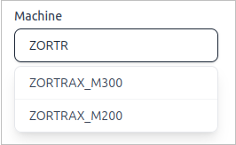
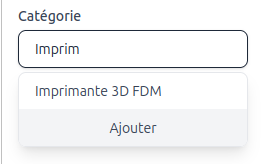
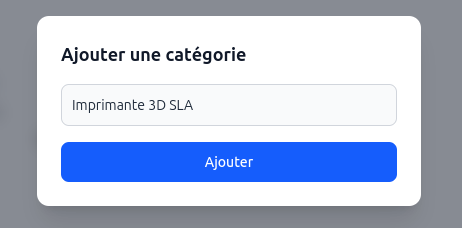

# Architecture plateforme Fablab V1

## Sommaire

1. [Pages](#1-pages)
2. [Méthodes](#2-méthodes)
3. [Base de données](#3-base-de-données)

## 1. Pages

### 1.1 Page d'accueil / de connexion

Deux types de connexion sont possibles :

- Connexion utilisateur : le visiteur renseigne un code (n° de PO ou code client, cf. [2.1 Connexion client](#21-connexion-client)), puis est redirigé vers son dashboard client.
- Connexion administrateur : le visiteur renseigne son nom et son mot de passe pour accéder à son dashboard admin (cf. [2.2 Connexion admin](#22-connexion-admin)).

### 1.2 Interface non-admin (commune aux PO et aux clients)

#### a) Visuel général

- Volet latéral à gauche avec le nom du client (ou l'intitulé du PO) et les onglets.
- Le reste de la page affiche le contenu des onglets.

#### b) Onglet Accueil

- 3 graphiques camembert (cf. [2.3 Graphiques camembert](#23-graphiques-camembert)) :
  - répartition des heures machines totales : le client peut choisir d'afficher la répartition en fonction des machines ou des projets ;
  - répartition des heures collaborateurs totales : le client peut choisir d'afficher la répartition en fonction du type (CAO / MO) ou des projets ;
  - répartition des consommables utilisés au total : le client peut choisir d'afficher la répartition en fonction de l'intitulé des consommables ou des projets.
- Raccourcis vers les projets du client.
- Historique des jobs avec recherche (cf. [2.9](#29-barre-de-recherche-des-jobs)), filtre (cf. [2.5](#25-filtre-des-jobs)), tri (cf. [2.6](#26-tri-des-jobs)) et bouton d'export Excel (cf. [2.7](#27-export-des-jobs)).

#### c) Onglet Projets

- Liste des projets du client (un seul pour les PO) avec intitulé et description (optionnelle).
- Une fois un projet sélectionné, le client peut voir :
  - les 3 mêmes camemberts (heures machines, heures collaborateurs, consommables), mais concernant uniquement ce projet ;
  - l'intitulé et la description du projet ;
  - la valorisation du projet, calculée automatiquement en fonction des consommables utilisés pour ce projet et des tarifs associés ;
  - un sous-onglet « Jobs » : liste des jobs associés au projet + barre de recherche de job, filtre, tri, export ;
  - un sous-onglet « Heures » : détail des heures utilisées pour le projet par machine, CAO et MO + filtre ;
  - un sous-onglet « Consommables » : détail de la quantité et du coût par consommable utilisé pour ce projet.

#### d) Onglet Machines

Liste toutes les machines du fablab (nom, description, catégorie, image (optionnelle)) + barre de recherche de machine, filtre.

#### e) Onglet Consommables

Liste tous les consommables disponibles au fablab (nom, description (optionnelle), catégorie, image (optionnelle)) + barre de recherche de consommable, filtre.

### 1.3 Interface admin

#### a) Visuel général

- Volet latéral à gauche avec le nom de l'admin.
- Le reste de la page affiche le contenu des onglets.

#### b) Onglet Accueil

- Graphique camembert avec la répartition des heures CAO et MO de l'admin. L'admin peut sélectionner la période (mois, année, total, etc.).
- Raccourcis vers les projets les plus travaillés par l'admin, selon le nombre de jobs du projet dont l'admin est opérateur (cf. [2.4 Ajouter un job](#24-ajouter-un-job)).
- Jobs en cours + bouton pour ajouter rapidement un job (cf. [2.4](#24-ajouter-un-job)).
- Bouton ouvrant une petite modale pour changer de mot de passe.

#### c) Onglet Jobs

- Affiche tous les jobs en détail (cf. [2.4](#24-ajouter-un-job)) avec barre de recherche de job, tri et filtre avancé (cf. [2.5](#25-filtre-des-jobs)).
- Bouton d'export (cf. [2.7](#27-export-des-jobs)).
- Bouton pour interrompre un job (ex : impression 3D ratée).
- Bouton pour ajouter un job.

#### d) Onglet Projets

- Accès à tous les projets + barre de recherche de projet, filtre.
- Bouton pour ajouter un projet en renseignant :
  - nom,
  - description (optionnelle),
  - client par suggestion (cf. [2.8](#28-sélection-par-suggestion)) (optionnel),
  - catégorie (PO, interne, externe, etc.) (optionnelle),
  - autre ?
- Lorsqu'un projet est sélectionné, l'admin voit la même page projet qu'un client (cf. [1.2 c)](#c-onglet-projets)).
- Bouton pour supprimer un projet.

#### e) Onglet Clients

- Liste des clients : nom, type (interne, externe, etc.), nombre de projets, code de connexion (cf. [2.1](#21-connexion-client)), coût total, autre ? + barre de recherche de clients, filtre
- Bouton pour supprimer un client.
- Bouton pour ajouter un client en renseignant : nom, type par suggestion (cf. [2.8](#28-sélection-par-suggestion)), code (choisi ou généré), autre ?
- bouton pour modifier/générer le code de connexion

#### f) Onglet Machines

- Liste de toutes les machines du fablab (nom, description, catégorie, image) + barre de recherche de machines, filtre.
- Bouton d'ajout d'une machine en renseignant : nom, description, catégorie par suggestion (cf. [2.8](#28-sélection-par-suggestion)), image (optionnelle).
- Bouton pour supprimer une machine.
- Bouton pour modifier les informations d'une machine.
- En cliquant sur une machine, l'admin peut voir :
  - le nom de la machine ;
  - la description ;
  - l'image ;
  - la catégorie ;
  - le nombre d'heures de fonctionnement sur une période, au choix (semaine, mois, année, etc.) ;
  - un sous-onglet « Jobs » : les jobs effectués par la machine + filtre, tri ;
  - un sous-onglet « Consommables » : détail de la quantité et du coût par consommable utilisé par la machine.

#### g) Onglet Consommables

- Liste de tous les consommables du fablab (nom, catégorie, unité, tarif ) + barre de recherche de consommable, filtre .
- Bouton pour modifier les informations d'un consommable.
- Bouton pour supprimer un consommable.
- Bouton pour ajouter un consommable en renseignant : nom, catégorie, unité, tarif, autre ?
- En cliquant sur un consommable, l'admin peut voir :
  - le nom du consommable ;
  - la catégorie ;
  - un sous-onglet « Jobs » : les jobs qui ont utilisé ce consommable + filtre, tri.

#### h) Onglet Collaborateurs

- Liste des collaborateurs avec leur nom et leur statut (contrat étudiant, intervenant occasionnel, autre? ) .
- Bouton pour ajouter un collaborateur en renseignant son nom et un mot de passe provisoire (cf. [2.2](#22-connexion-admin)).
- En cliquant sur un collaborateur, l'admin peut voir :
  - le nom ;
  - un graphique camembert des heures CAO et MO selon la période (mois, année, etc.) ;
  - un histogramme des heures passées par principaux projets  ;
  - un sous-onglet « Jobs » : les jobs dont le collaborateur est l'opérateur + filtre ;
  - un sous-onglet « Projets » : la liste des principaux projets du collaborateur.

---

## 2. Méthodes

### 2.1 Connexion client

Lorsqu'un admin crée un client ou un PO, il doit renseigner un code de connexion (ou cliquer sur un bouton « Générer un code »). Ce code est ensuite donné au client et lui permet de se connecter à son dashboard. Seules les personnes qui possèdent le code peuvent accéder au dashboard, afin d'éviter que n'importe qui puisse accéder au dashboard de n'importe quel client (en particulier pour les clients autre que PO ).

### 2.2 Connexion admin

Un compte admin ne peut être créé que par un autre admin, qui renseigne un mot de passe provisoire que le nouvel admin pourra ensuite modifier. Un admin se connecte en renseignant son nom et son mot de passe.

### 2.3 Graphiques camembert

En prenant l'exemple des heures machines, on peut vouloir afficher la répartition en fonction des machines, ou en fonction des projets (toutes machines confondues). L'utilisateur peut donc choisir l'axe de répartition à afficher. Exemple :

### 2.4 Ajouter un job

Seuls les admins peuvent ajouter un job. Un job est soit un job « machine », soit un job « collaborateur ».

#### a) Job machine

**Informations renseignées par l'admin :**

- machine, par suggestion (cf. [2.8](#28-sélection-par-suggestion)) ;
- consommable, par suggestion (les suggestions sont les consommables de même catégorie que la machine sélectionnée) ;
- quantité consommée (l'unité est renseignée automatiquement en fonction du consommable sélectionné) ;
- courte description (optionnelle) ;
- début (par défaut la date et l'heure actuelles, modifiable) ;
- durée ;
- opérateur, par suggestion : la personne qui lance la machine (par défaut l'admin connecté, modifiable) ;
- client, par suggestion (optionnel) ;
- projet, par suggestion (optionnel).

**Données contenues dans chaque job machine :**

- machine
- consommable
- quantité consommée
- courte description (éventuellement vide)
- début
- fin
- opérateur
- client (éventuellement vide)
- projet (éventuellement vide)
- statut (« en cours », « terminé », « interrompu ») : mis à jour automatiquement grâce aux champs « début » et « durée », ou si un admin a interrompu le job
- coût du consommable (calculé automatiquement)

#### b) Job collaborateur

**Informations renseignées par l'admin :**

- opérateur, par suggestion (par défaut l'admin connecté, modifiable) ;
- type (CAO ou MO) ;
- début (par défaut la date et l'heure actuelles, modifiable) ;
- fin ;
- client, par suggestion (optionnel) ;
- projet, par suggestion (optionnel) ;
- courte description (optionnelle).

**Données contenues dans chaque job collaborateur :**

- opérateur
- type
- début
- fin
- courte description (éventuellement vide)
- client (éventuellement vide)
- projet (éventuellement vide)

### 2.5 Filtre des jobs

Ce filtre est disponible sur les pages qui listent des jobs. Il permet de n'afficher que certains jobs : jobs d'une certaine machine, d'un certain opérateur, etc.

**2.5.1 Autres filtres** : des filtres similaires existeront pour les machines, les consommables, les collaborateurs, etc.

### 2.6 Tri des jobs

Permet de trier les jobs, notamment par date, du plus au moins coûteux, du plus au moins long, etc.

**2.6.1 Autres tris** : des tris similaires existeront pour les machines, les consommables, les collaborateurs, etc.

### 2.7 Export des jobs

Un bouton ouvre une petite modale qui permet d'exporter une liste de jobs au format Excel, avec la possibilité de les filtrer et de choisir une période (entre deux dates, le mois dernier, etc.).

### 2.8 Sélection par suggestion

Pour éviter de retaper à chaque fois le nom d'une machine ou d'un consommable, et pour s'assurer de sélectionner des objets ou des personnes qui existent dans la base de données, l'utilisateur commence à taper et des suggestions apparaissent. Il clique sur une suggestion pour valider la sélection. Exemple :

Pour les champs simples (catégorie, unité, etc.), si une option n'existe pas encore dans la base de données, la dernière suggestion (« Ajouter ») permet de l'ajouter.

Une fois cliqué sur « Ajouter », une petite modale apparaît 

Cela ajoute une nouvelle catégorie à la base de données, qui apparaîtra ensuite dans les suggestions.

### 2.9 Barre de recherche des jobs

Une barre de recherche est disponible sur chaque page qui liste des jobs. Elle recherche selon le nom, la description, le nom du projet, le nom du client et le nom de l'opérateur.

---

## 3. Base de données

La base de données peut être modifiée en fonctions de vos réponses aux questions

### 3.1 Personnes

### clients
 
 
| Colonne | Type | Obligations |
|---|---|---|
| id | int | clé primaire |
| nom | string | obligatoire |
| id_type_client | int | obligatoire, clé secondaire  |
| code_acces_hash | string | obligatoire, unique |
| date_creation | datetime | obligatoire (automatique) |
| date_archive | datetime | nullable |

### collaborateurs
 
 
| Colonne | Type | Obligations |
|---|---|---|
| id | int | clé primaire |
| nom | string | obligatoire |
| type | string | nullable |
| mdp_hash | string | obligatoire |
| date_creation | datetime | obligatoire (automatique) |
| date_archive | datetime | nullable |
 

### 3.2 Catalogue

### machines
 
| Colonne | Type | Obligations |
|---|---|---|
| id | int | clé primaire |
| nom | string | obligatoire |
| description | text | nullable |
| id_categorie | int | obligatoire, clé secondaire |
| chemin_image | string | nullable |
| date_creation | datetime | obligatoire (automatique) |
| date_archive | datetime | nullable |

### consommables
 
| Colonne | Type | Obligations |
|---|---|---|
| id | int | clé primaire  |
| nom | string | obligatoire |
| description | text | nullable |
| chemin_image | string | nullable |
| id_categorie | int | obligatoire, clé secondaire |
| id_unite | int | obligatoire, clé secondaire|
| fournisseur | string | nullable |
| prix_unite | decimal | nullable |
| format_brute_vente | string | nullable |
| date_creation | datetime | obligatoire (automatique) |
| date_archive | datetime | nullable |
 
### 3.3 Tables des suggestions

### categories
 
Partagée par les machines et les consommables
 
| Colonne | Type | Obligations |
|---|---|---|
| id | int | clé primaire |
| nom | string | obligatoire, unique |

 
### unites
 
| Colonne | Type | Obligations |
|---|---|---|
| id | int | clé primaire |
| unite | string | obligatoire, unique |
 
### types_client
 
Exemples : interne, externe, PO.
 
| Colonne | Type | Obligations |
|---|---|---|
| id | int | clé primaire |
| nom | string | obligatoire, unique |
 
### categories_projets
 
Exemples : PO, extérieur, interne.

| Colonne | Type | Obligations |
|---|---|---|
| id | int | clé primaire |
| nom | string | obligatoire, unique |

### fournisseurs
 
| Colonne | Type | Obligations |
|---|---|---|
| id | int | clé primaire |
| nom | string | obligatoire, unique |

### 3.4 Activité

### projets
 
| Colonne | Type | Obligations |
|---|---|---|
| id | int | clé primaire |
| nom | string | obligatoire |
| description | text | nullable |
| chemin_image | text | nullable |
| id_client | int | nullable, clé secondaire |
| id_categorie_projet | int | nullable, clé secondaire|
| date_creation | datetime | obligatoire (automatique) |
| date_archive | datetime | nullable |

### jobs
 
| Colonne | Type | Obligations |
|---|---|---|
| id | int | clé primaire |
| type | string | obligatoire, valeurs : machine,  collaborateur |
| status | string | obligatoire (rempli automatiquement), valeurs : en attente, en cours, termine, interrompu |
| id_operateur | int | obligatoire, clé secondaire|
| id_client | int | nullable, clé secondaire |
| id_projet | int | nullable, clé secondaire |
| description | text | nullable |
| debut | datetime | obligatoire |
| fin | datetime | obligatoire |
| id_machine | int | nullable (obligatoire si type = machine), clé secondaire |
| type_travail | string | nullable (obligatoire si type = collaborateur), valeurs : CAO, MO |

### job_consommables
 
| Colonne | Type | Obligations |
|---|---|---|
| id | int | clé primaire |
| id_job | int | obligatoire, clé secondaire |
| id_consommable | int | obligatoire, clé secondaire |
| cout_tot | decimal | obligatoire, (calculer automatiquement)|
| quantite | decimal | obligatoire |
| cout | decimal | obligatoire (calculer automatiquement) |

